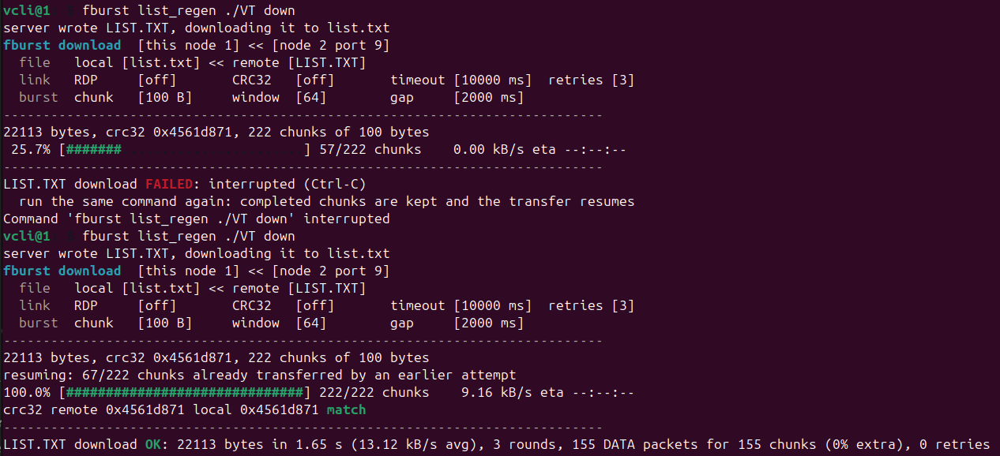

# libvftp

File transfer for a spacecraft and its ground station.

| Service | CSP port | How it moves data | Resume |
|---|---|---|---|
| **burst** | 9 | Sends many chunks back to back; the receiver reports the `{next,count}` ranges still missing | Upload and download, also across a chunk size change |
| **poll** | 8 | Stop-and-wait: one chunk per round trip | Upload and download, from a watermark, also across a chunk size change |

Main features:
- Every message of a transfer carries a session byte, so late packets of an earlier attempt are dropped instead of mixed in.
- End-to-end CRC-32 of the whole file. For a large file the server computes it over several requests, each reading a bounded amount (`VFTP_AGAIN`).
- Three ways to list a directory: paged (`ls`), written to a `LIST.TXT` file, and by index (`count`, `download_index`).
- Resume after a lost link, after an OBC reboot, and across a chunk size change between attempts.
- No dynamic allocation. Memory (a few KB up to 1 MB) is provided by the caller and sized in `vftp_user_config.h`.

## Layout

```
include/vftp/   public API (vftp.h includes all of it); one copy, shared by both sides
src/common/     libvftp_core:   wire codec, CRC-32, helpers both sides use
src/client/     libvftp_client: the client engine                      (needs core)
src/server/     libvftp_server: burst + poll engines, server-only helpers (needs core)
port/           sample ports: storage_posix, storage_ram, link_loopback, ccsds_spp (SPP over UDP)
examples/       standalone CCSDS SPP server/client + demo.sh
tests/          57 Unity tests (loopback with simulated loss, ASan/UBSan), split/ link checks
tools/          vendor.sh (copies into firmware/v-client), vftp_frames.c (prints example frames)
docs/           detailed documentation (see below)
```

## Quick start

```sh
make lib         # build/libvftp_core.a, libvftp_client.a, libvftp_server.a
make split-check # the client and the servers each link with libvftp_core alone
make test        # 62 tests, with ASan/UBSan
make arm-check   # ARM gcc 4.7 build with the firmware's strict flags
make demo        # CCSDS SPP server + client over UDP, with simulated loss
make frames      # every message as raw bytes, plus the CSP/KISS framing
make docs        # Doxygen -> build/docs/html/index.html (doxygen >= 1.18 draws the diagrams)
```

To use it in another project, copy `include/` and `src/common/` plus `src/client/` and/or `src/server/` (a ground station needs no server code, a spacecraft no client code), then write two small ports: file storage (`vftp_storage_t`) and the link (`vftp_link_t` on the client side, a transport loop on the server side). Step by step in [docs/porting.md](docs/porting.md).

## Documentation

| Page | Content |
|---|---|
| [libvftp/docs/architecture.md](libvftp/docs/architecture.md) | Architecture, burst/poll mechanics, resume, CRC, data flow, diagrams |
| [libvftp/docs/protocol.md](libvftp/docs/protocol.md) | Byte layout of every message, decoding without the library, CSP/RDP/KISS framing |
| [libvftp/docs/porting.md](libvftp/docs/porting.md) | Porting and integrating into a project (Make, CMake, waf), CCSDS, Modbus, RAM sizes |
| [libvftp/docs/deployment.md](libvftp/docs/deployment.md) | Ground station, OBC as server/client, link constraints, troubleshooting |

The API of every function is documented in the headers (Doxygen format). Run `make docs` for the HTML version.

## Limits

- Paths up to 55 characters. Names in listings up to 13 characters (an 8.3 name); a longer name is sent cut and flagged (`ls` shows `NAME~`), directories are flagged too (`NAME/`).
- Paged listings (`ls`) are by index: for a consistent snapshot of a directory that is changing, use `list_regen` (`LIST.TXT`).
- Files below 4 GiB (32-bit sizes).
- One transfer at a time per server instance; a second client gets `BUSY`.
- No security. If needed, it belongs to the transport layer.
- No version negotiation: when the packet format changes, upgrade both ends together.

Version: `VFTP_VERSION_STRING` in `include/vftp/vftp.h`.

