# Architecture and mechanics

"HOW LIBVFTP WORKS". Byte layouts are in [protocol.md](protocol.md); porting is in [porting.md](porting.md).

## 1. Layers

The library has two parts:

- **Library** (`include/` + `src/`): pure protocol logic, libc only -> `libvftp_core` (`src/common`: wire codec, CRC-32, shared helpers), `libvftp_client` (`src/client`) and `libvftp_server` (`src/server`).
- **Ports**: two interfaces -> `vftp_storage_t` (files) and `vftp_link_t` (send/receive datagrams, client side). On the server side the "port" is a transport loop that follows the 3 rules of section 6.

  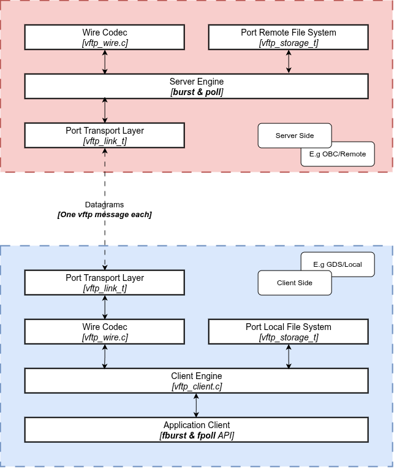

Each layer only knows the one below it. `vftp_wire.c` is the **single validation point**: every received packet goes through `vftp_decode`. A packet with an unknown type, a wrong length, a path that is too long or holds a NUL, or an item count larger than its array is rejected right there. Both services share one message table; each ignores the types it does not use.

### Detail example system architecture

  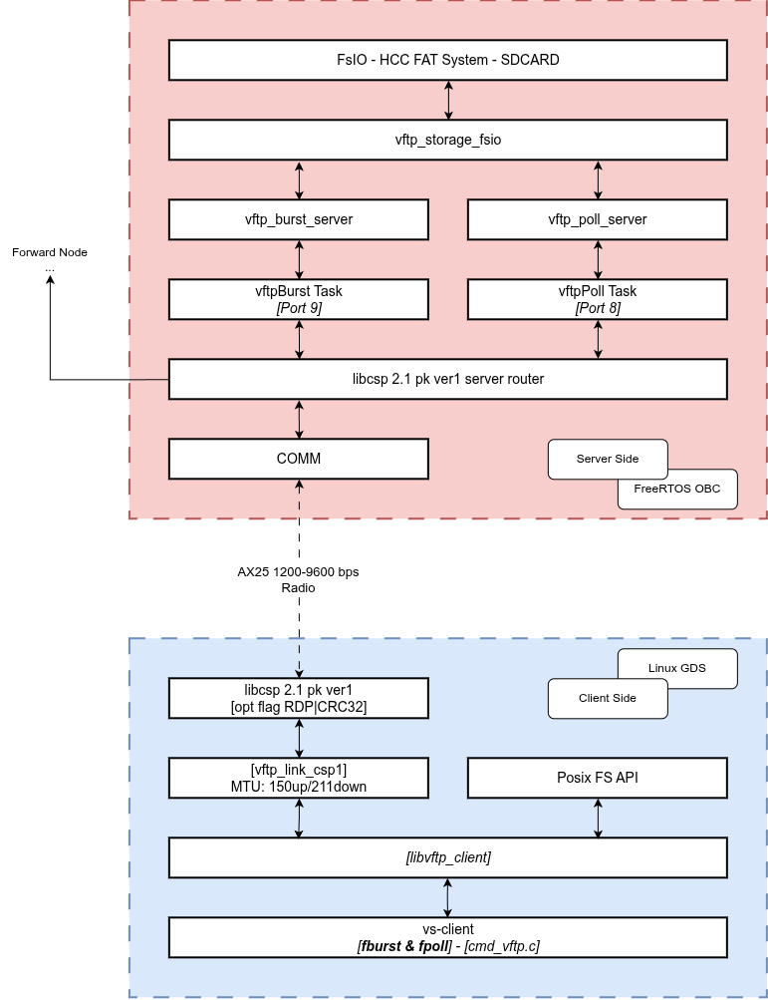

## 2. Two services

| | burst | poll |
|---|---|---|
| Purpose | Bulk transfers, fast | Simple and robust, fits request/response links |
| Download | The client sends the chunk ranges it still misses; the server sends all of them back to back | The client asks chunk by chunk (`GET_CHUNK n`), the server answers `DATA n` |
| Upload | The client sends up to `window_up` chunks, then asks `STATUS`; the server returns the ranges still missing | The client sends `DATA n` and waits for `DATA_ACK n` before the next chunk |
| Download resume | Yes: bitmap in a `.VFD` sidecar on the client | Yes: watermark in a `.VFP` sidecar on the client |
| Upload resume | Yes: bitmap in a `.VFM` sidecar on the server | Yes: watermark in a `.VFI` sidecar on the server |
| Server RAM | Bitmap + 32 KiB buffer (~1 MB by default) | ~1.6 KB |
| Listings | `LIST`, `LIST_REGEN`, `INDEX` | `INDEX` |

The two services are fully independent: separate port, task, instance and state. A server can run either one or both.

## 3. Burst

### 3.1 Download

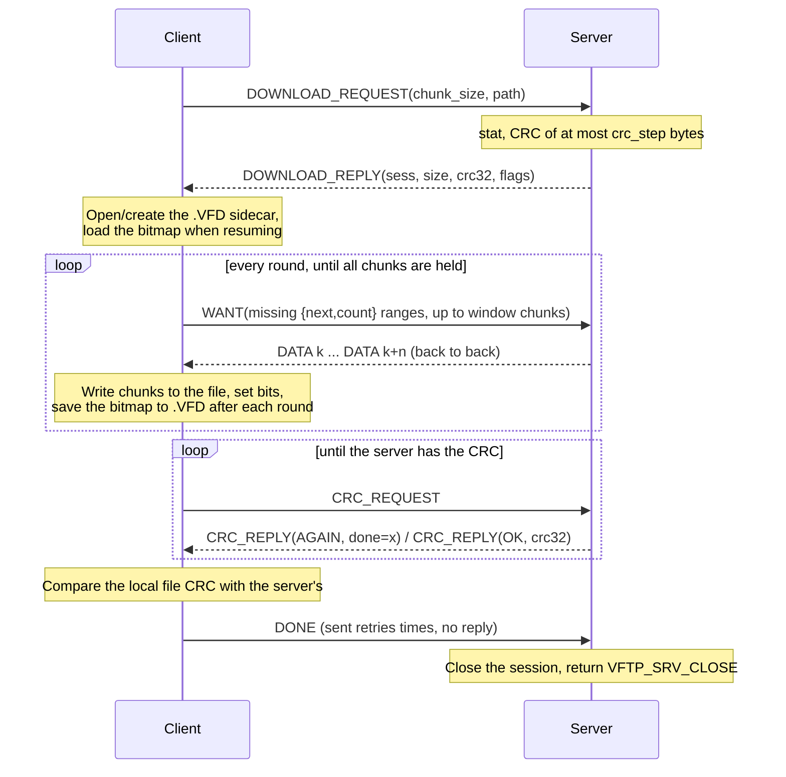

### 3.2 Upload

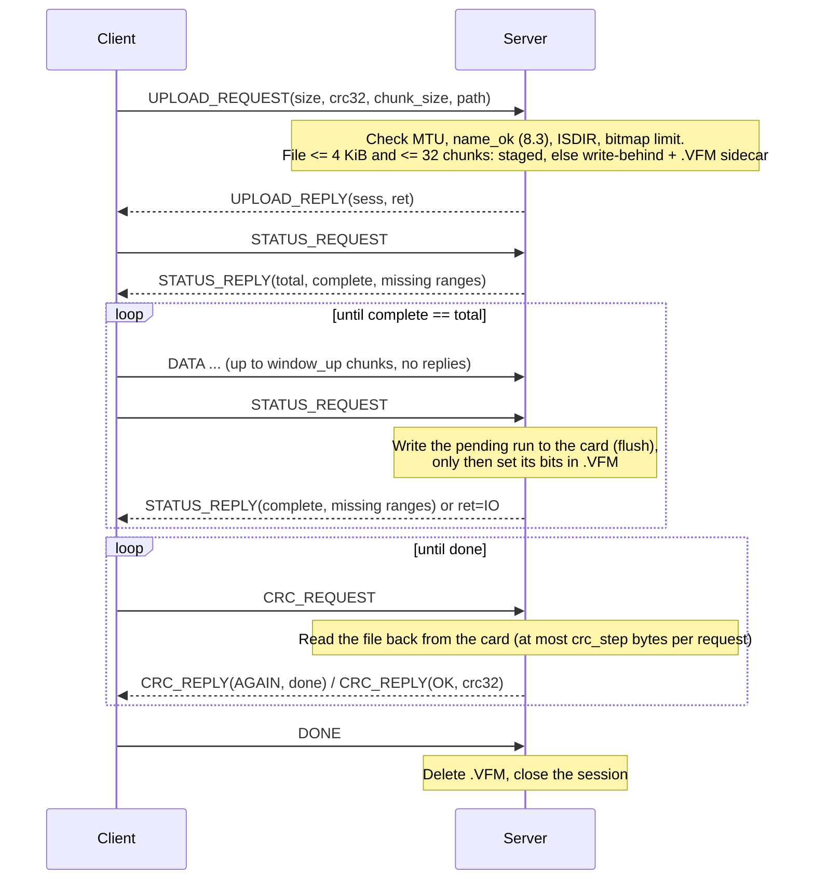

### 3.3 Client download loop

  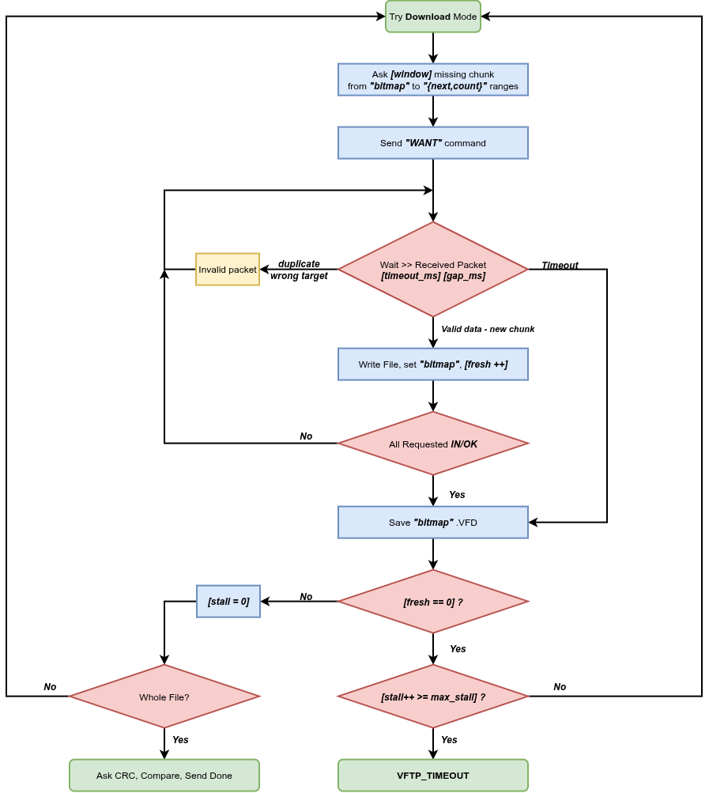

## 4. Poll

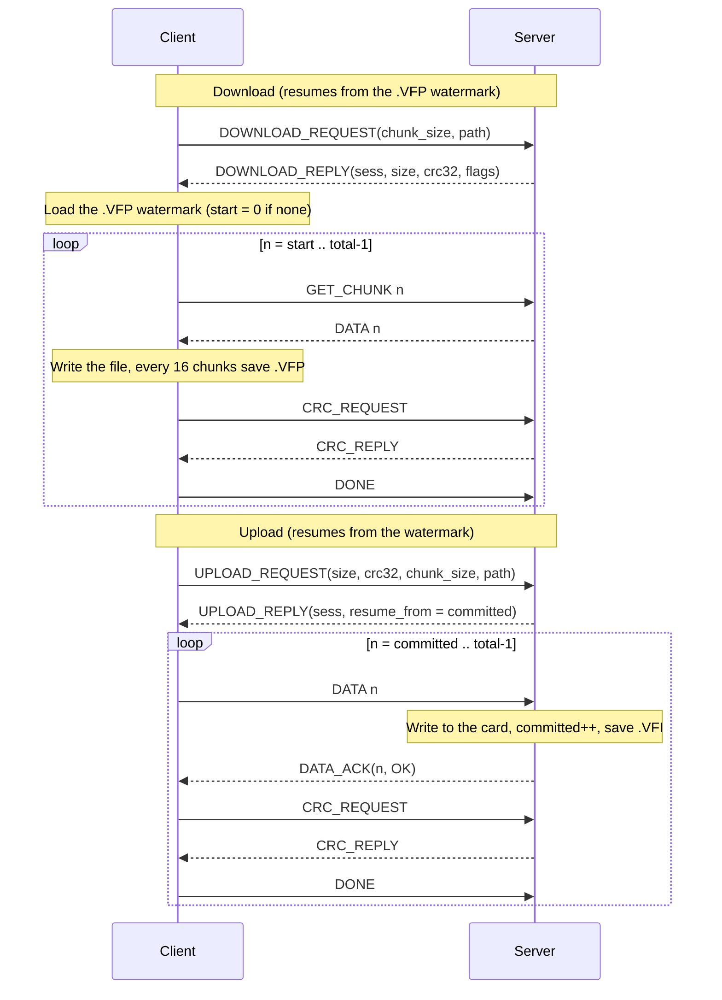

- **Idempotent**: if an ACK is lost and the client resends `DATA committed-1`, the server ACKs it again **without rewriting** it.
- **The watermark is the truth**: an out-of-order DATA gets `DATA_ACK(RANGE, chunk=committed)` and the client jumps back to `committed`.
- **A single write failure** also answers `RANGE` (the client resends that chunk). A second failure in a row answers `IO`.
- **An invalid GET_CHUNK** (out of range, no session) gets no reply; the client times out and asks again.
- **Download resume**: the client keeps a watermark in a `.VFP` sidecar next to the local file (chunks 0..n-1 written), saved every 16 chunks and when the call fails. A new call for the same remote file (same size, CRC, path) goes on from there, as long as the local file still holds those bytes. A crash costs at most 16 chunks.

## 5. Resume

### 5.1 Sidecar files

| File | Where | Written by | Content |
|---|---|---|---|
| `XXXXXXXX.VFM` | Server **root** | Burst server (upload) | 24 B header + bitmap |
| `XXXXXXXX.VFI` | Server **root** | Poll server (upload) | 24 B header (with the watermark) |
| `XXXXXXXX.VFD` | **Next to the local file** | Client (burst download) | 24 B header + bitmap |
| `XXXXXXXX.VFP` | **Next to the local file** | Client (poll download) | 24 B header (with the watermark) |

`XXXXXXXX` = CRC-32 of the full path, in hex: a valid 8.3 name on every filesystem. On the server, sidecars live in the root, so `ls`/`count`/`index` of the data directories never see them. Header layout in [protocol.md](protocol.md#sidecars).

### 5.2 Resume decision

  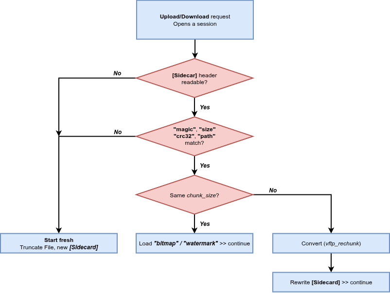

## 6. The three rules of the server transport loop

The server engine **does not read the network and has no timers**: it only handles the packets it is given. The port (transport loop) does exactly three things:

  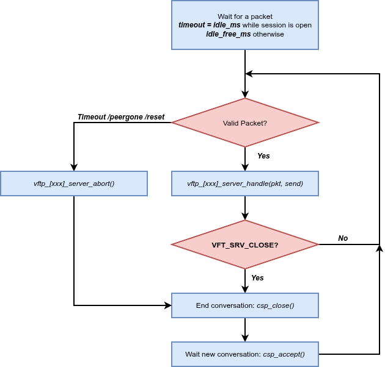

1. Every received packet -> `handle()`. Replies leave through the `send` callback: none, one, or many (burst download).
2. `handle()` returns `VFTP_SRV_CLOSE` -> end the conversation. A connectionless transport ignores it.
3. The conversation ends for **any other reason** (timeout, peer gone, reset) -> call `abort()`. This rule frees the service for the next client. `abort()` is idempotent and keeps the sidecar, so an upload can still resume.

A **connectionless** transport (UDP, CCSDS SPP) has no "connection closed" event, so its loop applies rule 3 with the `activity` counter: if a service is busy and `activity` has not moved for `idle_ms`, call `abort()`. `activity` only counts packets that belong to the open session, so a new request refused with `BUSY` cannot keep a dead session alive.

## 7. Server engine states

  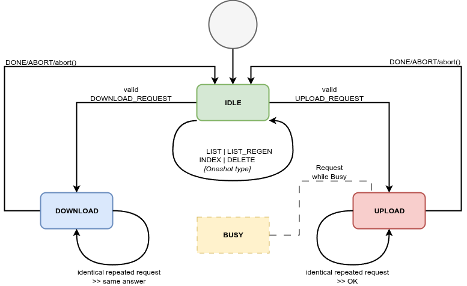

### 7.1 Sessions

The server gives each transfer a session byte (1..255) in its DOWNLOAD_REPLY / UPLOAD_REPLY, and every later message of that transfer carries it. This keeps a new transfer safe from **late packets of an earlier one**: on a slow link, a client may time out, run again and open a new session while packets of the first attempt are still in flight.

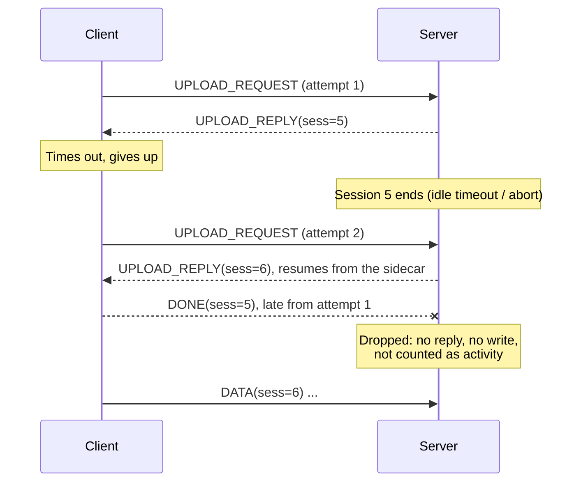

Rules, chosen so that a mismatch can never leave anything stuck:

| Where | Packet | What happens |
|---|---|---|
| Server, transfer open | session byte matches | Handled normally |
| Server, transfer open | session byte differs | **Dropped**: nothing written, no reply, `activity` unchanged (so the idle timeout still frees a dead session) |
| Server, transfer open | identical DOWNLOAD/UPLOAD_REQUEST | Same answer, **same** session (the first reply was lost) |
| Server, transfer open | different request | `BUSY`, session 0 |
| Server, idle | a session message | Answered as with nothing open (e.g. `INVAL` to CRC_REQUEST), session echoed |
| Client | reply of another session | Ignored, keeps waiting; at worst a timeout, and the next run resumes from the sidecar |

Sessions start at 1 after a reboot and wrap from 255 to 1. A late packet can only match by accident if 255 transfers happened in between, or the server rebooted and the old and new transfers both got the same number; the end-to-end CRC still catches any damage.

## 8. End-to-end CRC

A transfer is reported successful only when the CRC-32 (IEEE, as zlib/PNG) of the **whole file** matches on both ends.

For a large file, computing the CRC in one go could keep the server busy for minutes (1 GB on SD). The server therefore runs an **incremental CRC job**:

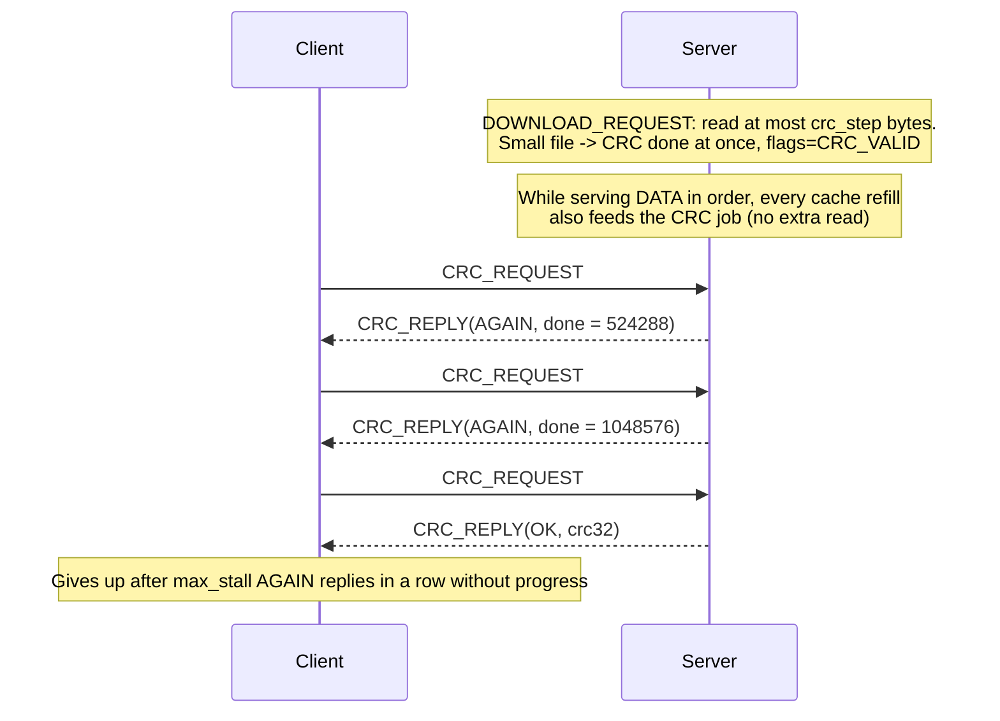

- `crc_step` is 1 MiB by default (OBC firmware: 512 KiB). Each request reads at most that much, so the time a task is held is always bounded.
- In-order download: the CRC is usually done by the time the last chunk leaves. Resumed download (chunks already held are skipped): the rest is read over a few `AGAIN` rounds.
- Upload: the CRC is always read back from the card.
- The CRC in `DOWNLOAD_REPLY` is valid only if `flags & VFTP_DL_CRC_VALID`. Otherwise the client writes 0 into its sidecar and relies on the final CRC_REPLY.

## 9. Directory listings

| Method | Messages | Use it when |
|---|---|---|
| 1. `LIST.TXT` | `LIST_REGEN`, then download `LIST.TXT` | You want a text file, to keep or read later |
| 2. Paged | `LIST_REQUEST(offset, limit)` -> `LIST_REPLY` | Browsing interactively (`fburst ls`) |
| 3. By index | `INDEX_REQUEST(dir, n)` -> `INDEX_REPLY` | Downloading the n-th file without knowing its name (`download_index`), or counting (`n = 0xFFFFFFFF`) |

All three use the same entry order (the port's `walk()` order), so the number `ls` prints is the index `download_index` takes.

- **Pages are filled by bytes**: names are length-prefixed, so a page holds as many entries as fit the MTU (9 full 8.3 names at 211 bytes, more when names are short). Each entry has a `flags` byte: `VFTP_ENTRY_DIR` (csp-client prints `NAME/`) and `VFTP_ENTRY_NAME_CUT` (a name longer than 13 characters was cut; `download_index` refuses it with `BADNAME` rather than fetch a wrong path). `mtime` is Unix seconds (UTC), 0 when unknown.
- **Paging is by index**, so a directory that changes while it is being paged (a file written or deleted between two pages) can shift entries: one may be shown twice or skipped. Nothing is corrupted, but **for a consistent snapshot use `LIST_REGEN`**: the server walks the directory once and writes the whole listing to `LIST.TXT`.
- **One directory pass per page**: with a port that has `walk()`, listing n entries costs O(n) directory reads. Without `walk()` the library falls back to indexed `dirent()`, O(n²). That was the cause of the old `ls` hang.
- **Last LIST_REPLY page -> the server ends the conversation at once**, so the connection is no longer held for 5 s and the next `ls` does not wait.
- **LIST.TXT always lives in the root**: the server writes `LISTTMP.TXT` and only then renames it to `LIST.TXT`, so nobody downloads a half-written file, and a failed regeneration leaves the previous `LIST.TXT` intact. When listing the root, neither file lists itself. Format: a `# <dir>` line, one `"%10lu YYYY-MM-DD_HH:MM name[/][~]"` line per entry (date in UTC, `-` when the filesystem keeps no dates; `/` = directory, `~` = name cut at 13 characters), a final `# <n> entries` line.

## 10. Client robustness rules

- Every control round trip (request -> reply) is retried `retries` times; the server answers a repeated request idempotently.
- A packet that is not the awaited reply (a late DATA from the previous round, a duplicate, a reply of another session) is skipped, not treated as an error. Up to 512 such packets are skipped per wait.
- `DONE` has no reply, so it is sent `retries` times (the server tolerates duplicates).
- Errors are kept apart: `VFTP_REMOTE` (the server refused; its reason is in `remote_ret`), `VFTP_TIMEOUT` (no reply / no progress), `VFTP_LINK` (transport broken); everything else is a local file error.

## 11. Detailed data flow

  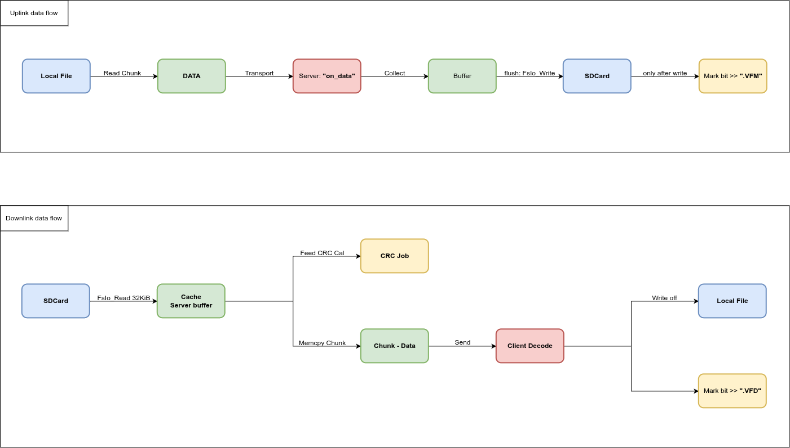

